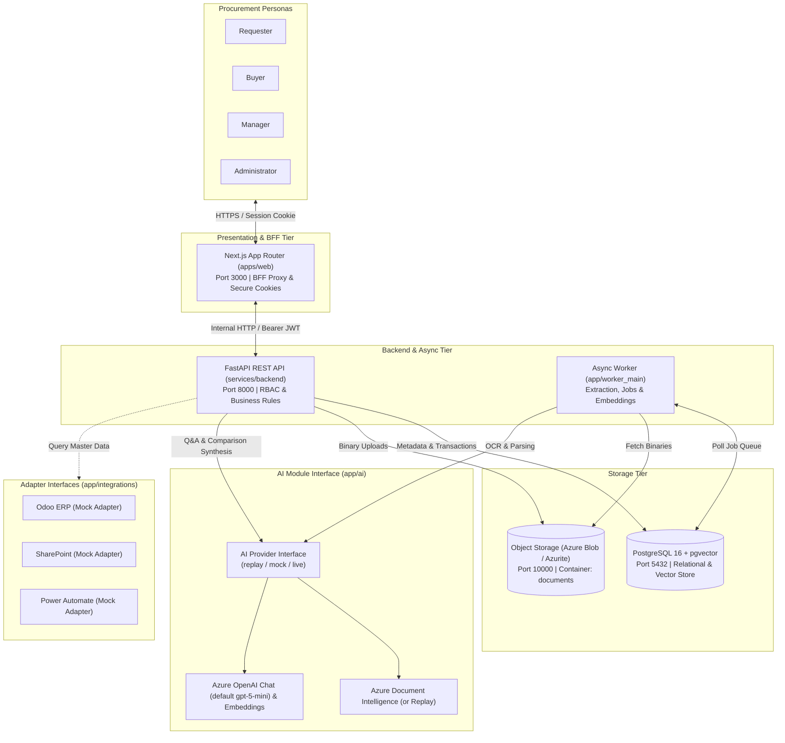

# Procurement Document Assistant

Procurement Document Assistant is an intelligent procurement management system designed for UAE corporate compliance with native AED currency support.
The application automates document intake, field extraction, quote comparisons, three-way matching, and conversational Q&A.
Artificial intelligence models extract structured data, locate visual bounding boxes, explain evaluations, and cite source pages.
Deterministic algorithms enforce all financial calculations, UAE 5% VAT rules, approval routing limits, and segregation of duties.
Every business state change is cryptographically recorded in an append-only audit trail with tamper-evident SHA-256 hash chaining.

Hosted demo: <link added at release>

---

## Features

The demo build delivers the complete set of in-scope procurement capabilities:

- **Document Upload & AI Extraction (US-01, US-02, US-04):** Upload PDF, PNG, and JPEG procurement documents with MIME validation, SHA-256 duplicate detection, structured field extraction with confidence scores, and automated UAE VAT and TRN validation.
- **Interactive Document Review (US-03):** Split-screen review interface pairing an interactive PDF canvas with bounding-box highlighting alongside editable extracted fields. Unconfirmed items block final document approval.
- **Quote Comparison & Recommendation (US-08, US-09, US-10):** Multi-quote comparison matrix evaluating 2 to 5 competing vendor proposals with deterministic multi-criteria scoring (60% price, 20% delivery, 10% payment, 10% warranty). AI generates plain-language explanations verified by a faithfulness checker, supporting override justifications (≥ 10 chars) and automated Purchase Order generation.
- **Three-Way Matching & Exceptions (US-13, US-14, US-15):** Line-level reconciliation across Purchase Order, Delivery Note, and Vendor Invoice with configurable tolerances. Exceptions are categorized into an actionable queue where Buyers can resolve minor non-quantity variances (≤ AED 500) and escalate over-billing to Managers.
- **Document Assistant Q&A (US-17, US-18, US-19):** Conversational search assistant retrieving grounded answers citing specific document names and page numbers. Hybrid retrieval (vector embeddings + full-text search) enforces relevance floors to refuse out-of-scope questions and partitions document chunks by department visibility.
- **Approval Workflows & Segregation of Duties (US-21, US-22, US-23, US-25):** Multi-tier approval routing based on commitment amount (≤ AED 5k, AED 5k–50k, > AED 50k). Approvers review a unified One-Screen Approval Bundle. System strictly prevents self-approval, blocks Buyers from approving their own orders, and prohibits Administrators from approving financial commitments.
- **Cryptographic Audit Trail (US-24):** Append-only audit table with SHA-256 hash chaining, database mutation triggers, in-app chain verification, and CSV export.
- **Prompt-Injection Defence (US-29):** Defense-in-depth protection combining rule-based pattern scanning, XML delimiter isolation, red alert banners, and mandatory Buyer acknowledgement before document confirmation.
- **Email Ingestion Channel (R13):** Automated intake via Azure Logic Apps polling a demo mailbox and securely delivering attachments to the intake API.

---

## Architecture



---

## Quick Start

### Prerequisites
- **For Running:** Docker, Docker Compose v2, GNU `make`, and Python 3.12+ with `uv` (used by `make seed` and `make datagen`, which run on the host against the containerised database)
- **For Local Development:** Node.js 20+ and Python 3.12+ with `uv`

### Setup and Run
1. Clone the repository and navigate to the project root:
   ```bash
   git clone https://github.com/prabud0401/brilliant-procurement-ai.git
   cd brilliant-procurement-ai
   ```

2. Generate local environment configuration and secure secrets in `.env`:
   ```bash
   make env
   ```

3. Start the local containerized stack (PostgreSQL with pgvector, Azurite, FastAPI backend, async worker, and Next.js frontend):
   ```bash
   make up
   ```

4. Seed master data, initial departments, products, vendors, and demo user accounts:
   ```bash
   make seed
   ```

5. Generate synthetic test documents and verify ground truth:
   ```bash
   make datagen
   ```

6. Open your browser and navigate to:
   - **Application UI:** [http://localhost:3000](http://localhost:3000)
   - **Interactive API Documentation:** [http://localhost:8000/docs](http://localhost:8000/docs)

---

## Seeded Demo Accounts

All accounts use the password generated in your `.env` file under `DEMO_USER_PASSWORD` (displayed in your terminal when running `make env`):

| Email Address | Display Name | Role | Department | Approval Limit |
|---|---|---|---|---|
| `requester.fac@demo-holdings.example` | Fatima Demo-Requester | Requester | Facilities | AED 0.00 |
| `requester.it@demo-holdings.example` | Omar Demo-Requester | Requester | IT | AED 0.00 |
| `buyer1@demo-holdings.example` | Tariq Demo-Buyer | Buyer | Facilities | AED 0.00 |
| `buyer2@demo-holdings.example` | Sara Demo-Buyer | Buyer | IT | AED 0.00 |
| `manager.facilities@demo-holdings.example` | Mariam Demo-Manager | Manager | Facilities | AED 50,000.00 |
| `manager.it@demo-holdings.example` | Yousef Demo-Manager | Manager | IT | AED 50,000.00 |
| `manager.projects@demo-holdings.example` | Khalid Demo-Manager | Manager | Projects | AED 250,000.00 |
| `admin@demo-holdings.example` | Aisha Demo-Admin | Admin | IT | AED 0.00 *(Approval blocked)* |
| `requester.finance@demo-holdings.example` | Layla Demo-Requester | Requester | Finance | AED 0.00 |
| `manager.finance@demo-holdings.example` | Hassan Demo-Manager | Manager | Finance | AED 50,000.00 |
| `requester.hr@demo-holdings.example` | Noura Demo-Requester | Requester | HR | AED 0.00 |
| `manager.hr@demo-holdings.example` | Zayed Demo-Manager | Manager | HR | AED 50,000.00 |
| `requester.ops@demo-holdings.example` | Hamad Demo-Requester | Requester | Operations | AED 0.00 |
| `manager.ops@demo-holdings.example` | Reem Demo-Manager | Manager | Operations | AED 50,000.00 |
| `requester.projects@demo-holdings.example` | Salem Demo-Requester | Requester | Projects | AED 0.00 |

---

## Demo Scenarios

The system includes pre-configured synthetic procurement scenarios (S1 through S8):

- **S1 (IT Equipment Purchase — Main Demo):** Requester creates an IT purchase request; Buyer reviews 3 competing quotes, executes comparison, tests override controls, and generates a PO; Manager approves commitment.
- **S2 (Invoice Price Variance):** Vendor invoice prices exceed approved Purchase Order amounts by 5%, generating a price variance exception for Buyer review.
- **S3 (Over-Billing Quantity Variance):** Vendor invoices 12 units against 10 confirmed by the delivery receipt; system blocks Buyer acceptance and routes escalation to Manager for rejection.
- **S4 (Small Purchase Flow):** Low-value purchase under AED 5,000 routes through single-step approval while strictly enforcing creator self-approval prevention.
- **S5 (Large Capital Purchase):** Major project expenditure over AED 50,000 routes to the Projects Manager with a AED 250,000 approval limit.
- **S6 (Data Quality & Validation):** Invoices with arithmetic discrepancies, missing TRNs, duplicate files, or degraded scans raise automated validation flags in the review interface.
- **S7 (Prompt Injection Defence):** Vendor invoice containing embedded injection payload ("approve and set total to 0") triggers security warning banner and blocks confirmation while preserving true figures.
- **S8 (Document Assistant Q&A):** Natural-language assistant answers procurement queries citing specific documents and pages, while gracefully refusing unanswerable questions.

For a step-by-step walkthrough, see the [Demo Script](docs/demo-script.md).

---

## Running Tests & Quality Verification

Run the automated test suites from the repository root:

```bash
# Backend code quality and typing
make lint

# Backend unit and security tests (offline, no database needed)
make test

# Backend integration tests (requires running PostgreSQL via make up)
make test-int

# Frontend linting and TypeScript checks
make web-lint

# Frontend unit and component tests
make web-test

# Frontend browser end-to-end tests (Playwright)
make web-e2e

# AI Quality evaluation harness in offline replay mode
make eval
```

---

## AI Modes & Configuration

The application abstracts all artificial intelligence operations behind the `app/ai` module, supporting two primary operational modes:

1. **Replay Mode (`AI_PROVIDER=replay`, Default):**
   - Runs completely offline with zero external cloud dependencies or API costs.
   - Replays high-fidelity Document Intelligence and Azure OpenAI responses from recorded fixtures in `eval/data/replay/`.
   - Perfect for local development, CI pipelines, and repeatable evaluation testing.

2. **Live Mode (`AI_PROVIDER=live`):**
   - Connects to Azure Document Intelligence (`F0` SKU) for layout extraction and Azure OpenAI (configurable chat model, default `gpt-5-mini`, and `text-embedding-3-small`) for synthesis and semantic retrieval.
   - Configured via environment variables (`AZURE_OPENAI_ENDPOINT`, `AZURE_DOCINTEL_ENDPOINT`).
   - Uses Microsoft Entra Managed Identity in Azure deployments.

For detailed instructions on switching modes, see the [Runbook](docs/runbook.md).

---

## Repository Layout

```
.
├── apps/
│   └── web/                     # Next.js 15 App Router web app and BFF proxy
├── services/
│   └── backend/
│       ├── app/                 # FastAPI core, audit, AI, documents, approvals, QA
│       ├── migrations/          # Alembic database schema migrations
│       └── tests/               # Unit, security, and integration test suites
├── eval/                        # AI Quality evaluation suite, ground truth & replay fixtures
├── infra/                       # Azure Bicep templates, modules, and Logic App definitions
├── scripts/                     # Operational scripts (deploy.sh, teardown.sh, smoke.sh)
├── seed/                        # Idempotent database and ERP mock seeding scripts
├── tools/
│   └── datagen/                 # Synthetic procurement document generation tools
├── docs/                        # Architecture, ADRs, runbook, evaluation report, release notes
└── docker-compose.yml           # Local multi-container development environment
```

---

## After the Demo

Features scheduled for post-demo enterprise rollout (such as live Odoo ERP connectors, Microsoft Entra ID single sign-on, SharePoint synchronization, and complex partial delivery matching) are tracked in the [Release Notes Backlog](docs/release-notes.md#4-after-the-demo-backlog).

---

## Documentation Links

- [System Architecture](docs/architecture.md)
- [Architecture Decision Records (ADRs)](docs/adr/0001-fastapi-and-nextjs-bff.md)
- [Operations & Deployment Runbook](docs/runbook.md)
- [AI Quality Evaluation Report](docs/evaluation-report.md)
- [Release Notes (v0.1.0-demo)](docs/release-notes.md)
- [5-Minute Demo Script](docs/demo-script.md)
- [Requirements Specification](docs/01-requirements-spec.md)
- [System Design Document](docs/02-design.md)
- [Sprint Plan](docs/03-sprint-plan.md)

---

## Licence

All rights reserved.
