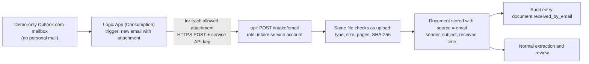
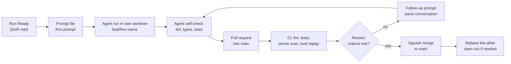
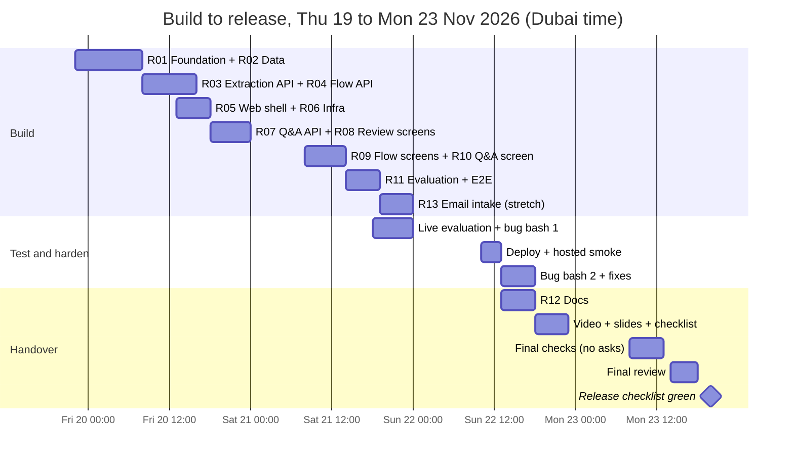

# Document control

| Item | Value |
|---|---|
| Document | 03 Sprint Plan (shared copy) |
| Project | Procurement Document Assistant (technical assessment demo) |
| Prepared for | Brilliant Investment & Development, Abu Dhabi |
| Prepared by | Prabudeva Udayasooriyan |
| Based on | 01 Requirements Specification v1.0 and 02 System Design v1.0 (both approved 19 November 2026) |
| Status | Draft for review. No code is written until this plan is approved. |
| Version | 2.1, 19 November 2026. v2.0 replaced v1.0 when the deadline moved to the end of Monday 23 November 2026 (real dates, smaller scope). v2.1 adds email intake through Azure Logic Apps as a stretch item (section 3.3, run R13). |

All times are Dubai time (UTC+4). Requirement IDs (US-xx, NFR-xx, AIQ-xx) refer to the Phase 1 specification; design sections refer to the Phase 2 design.

# Contents

1. Summary
2. Assumptions and defaults
3. Scope: what ships and what waits
4. Quality bar
5. How the build is run
6. Calendar
7. Build runs
8. Hardening and bug bash
9. Release checklist
10. Definition of Ready and Definition of Done
11. Branch, pull request and review flow
12. Risks to the deadline
13. Timeline chart
14. Open questions

# 1. Summary

- **Deadline:** everything (build, testing, deployment, handover documents, demo video and slides) is finished by the end of **Monday 23 November 2026**. The aim is to be ready to show by **Sunday 22 November, 23:00**, with Monday afternoon kept for a final review.
- **A working application, not a demo shell.** Every feature in scope works end to end on the hosted link, with seeded accounts for each role. There are no "coming soon" screens and no stubs in the product. The only mocks are the Odoo, Microsoft 365 and Entra ID integrations, and they are shown openly as adapters that switch to the real systems by configuration.
- **Smaller scope, done properly.** The demo covers the Must stories that make the strongest case: AI extraction with review, quote comparison with an explained recommendation, three-way match, Q&A with citations, approval workflow with role-based access, the audit trail and prompt-injection defence. Should and Could stories move to a clearly labelled after-demo backlog (section 3.2). If something cannot be finished properly, it is cut, not shipped half done.
- **Stretch item: email intake.** Supplier documents emailed to a demo-only mailbox are picked up by an Azure Logic App and sent into the normal extraction flow (section 3.3, run R13). It is built only if the core is on track on Saturday evening and ships only if it passes the release checklist by gate G2; otherwise it moves to the after-demo backlog.
- **Twelve bigger build runs (R01–R12)** replace the 31 small tasks of v1.0. Each run still has one branch, one pull request and one review. Independent runs work in parallel on separate branches and folders, at most two at a time.
- **Two approval steps before any Azure spending:** G1 (Azure AI services) and G2 (hosting). Nothing is created in Azure before each is approved.
- **Hosted window:** Sunday 22 November to Sunday 29 November; teardown on **Sunday 29 November**, with a zero-cost check on Wednesday 2 December.
- **Hardening and bug bash on Saturday evening and Sunday**, then a release checklist (section 9) that must be all green before anything is sent to Brilliant.

# 2. Assumptions and defaults

| ID | Assumption | What changes if it is different |
|---|---|---|
| A-01 | **Hosting:** the app is hosted on Azure from Sunday 22 to Sunday 29 November, and a recorded run is kept as a backup. | Local only: G2 and the deploy steps drop; the video becomes the main proof. |
| A-02 | **Integrations:** Odoo, Microsoft 365 (SharePoint, Teams through Power Automate) and Entra ID run as mocks with synthetic data, behind adapters. The app labels them as such (for example "Odoo (mock adapter)" in the admin integrations page). | A test tenant or Odoo instance would be connected after the demo. |
| A-03 | **Buyer exception limit:** AED 500, never for over-billed quantity, configurable. | Only the default changes. |
| A-04 | **Model:** gpt-4o-mini and text-embedding-3-small, set in configuration. | Another small model is a configuration change plus one evaluation run. |
| A-05 | **Seven phases:** (1) Requirements, (2) Design, (3) Sprint plan, (4) Build, (5) Testing, (6) CI/CD and deployment, (7) Handover. The specification listed six; this replaces that list. Phases 4–7 now overlap in time. | – |
| A-06 | **Repository:** `prabud0401/brilliant-procurement-ai` on GitHub, private until shared on purpose. | – |

# 3. Scope: what ships and what waits

## 3.1 In the demo (fully working)

| Area | Stories | What the panel sees working |
|---|---|---|
| Upload and AI extraction | US-01, US-02, US-04 | PDF upload with file checks; fields and line items with confidence; arithmetic, VAT, TRN and date checks |
| Review | US-03 | Split screen with the page and highlight box; correct and confirm; confirm blocked while flags are open |
| Quote comparison | US-08, US-09, US-10 | Side-by-side table, deterministic score, plain-language explanation checked against the facts, override with reason, PO from the chosen quote |
| Three-way match | US-13, US-14, US-15 | Line-level match with tolerances, exception queue with reasons and actions (accept within AED 500, escalate, reject) |
| Q&A with citations | US-17, US-18, US-19 | Answers with document and page citations, refusal when the documents do not answer, results limited to what the user may see |
| Approvals and access | US-21, US-22, US-23, US-25 | Requests routed by amount, one-screen approval, self-approval blocked; Admin manages users, roles, limits, thresholds and tolerances |
| Audit trail | US-24 | Append-only audit log with hash chain, viewer and CSV export |
| Prompt-injection defence | US-29 | Hidden instructions ignored and the document flagged |
| Platform | NFR-SEC, NFR-OBS, NFR-REL | Sign-in with seeded accounts per role, health checks, clear error messages, monitoring in Application Insights, CI/CD |

That is all 19 Must stories. Demo scenarios S1 (main purchase), S3 (over-billing), S4 (small purchase and self-approval block), S6 (data-quality flags, reduced set), S7 (injection) and S8 (Q&A) are seeded. S2 and S5 are seeded if R02 finishes them inside its run; they are not required for release.

## 3.2 After the demo (not in this release)

These are not shown as buttons or menu items in the app. They are listed in the README as next steps.

| Story | Priority | Why it waits |
|---|---|---|
| US-05 Vendor match to the Odoo vendor list | Should | Vendors are picked from the seeded list on the review screen instead |
| US-06 Duplicate warning (vendor and number) | Should | The exact-file duplicate check (same SHA-256) stays, because it is part of the upload checks |
| US-07 SharePoint import | Could | Needs a test tenant to be meaningful |
| US-11 Adjustable scoring weights | Should | Weights are fixed at 60/20/10/10 and shown on screen |
| US-12 Gap flags (expired quote, other currency, missing TRN) | Should | Missing TRN is still caught by the extraction checks (US-04) |
| US-16 Partial deliveries | Should | The demo uses one full delivery note per PO |
| US-20 Click a citation to open the page | Should | Citations show document name and page number as text |
| US-26 Teams notification through Power Automate | Should | Approvers see items in their in-app inbox |
| US-27 Write approved PO to Odoo | Should | The PO stays in the app with status Approved |
| US-28 Microsoft Entra ID sign-in | Should | Seeded accounts per role with password sign-in on the hosted link |

Also reduced for the deadline, with the full versions after the demo: the evaluation set is 20 documents, 30 questions and 15 injection cases (the specification asks for 40, 60 and 30), and the scanned or degraded subset is 5 documents. The evaluation report states these numbers plainly.

## 3.3 Stretch: email intake through Azure Logic Apps

Approved on 19 November 2026 as a stretch item. It mirrors how Brilliant would do the same thing with Power Automate in Microsoft 365: Logic Apps uses the same workflow designer and the same Outlook connectors, so the flow can be rebuilt as a Power Automate flow in Brilliant's tenant with no change to the application.

| Part | How it works |
|---|---|
| Mailbox | A new Outlook.com mailbox created only for the demo, holding no personal mail. Its password stays with the project owner; the Logic App connects to it once through the Outlook.com connector sign-in at deployment. |
| Trigger | "When a new email arrives" with "only with attachments" on, polling every 5 minutes. |
| Filtering in the Logic App | Only PDF, PNG and JPEG attachments up to the upload size limit are sent; anything else is skipped and logged in the run history. Inputs and outputs are marked secure so attachment content and the key are not kept in run history. |
| Call to the API | One HTTPS POST per attachment to `POST /api/v1/intake/email` (multipart: file, sender, subject, received time, message ID). The service API key is sent in a header. |
| The key | Stored in Key Vault and passed to the Logic App as a secure parameter at deployment. Never in the repository, prompts, logs or run history. Rotated at teardown by deleting the vault. |
| API side | A dedicated `intake` service-account role that can only create documents through this endpoint; it cannot read, list or change anything. The same file checks as a normal upload apply, plus an optional sender allowlist setting and a rate limit. Duplicate files (same SHA-256) are rejected as usual. |
| Data saved | `source = email`, sender, subject, received time and message ID on the document, and the same values in the audit entry. The document then lands in the Buyer queue and goes through the normal extraction and review. |

If it is not fully working and checked by Sunday 10:00, it is not deployed, the Logic App is not created, and it is listed in the after-demo backlog. It is never shipped half done.

# 4. Quality bar

Brilliant receives a working application. These rules apply to everything in section 3.1:

1. **End to end or not at all.** A feature counts only when it works through the browser on the hosted link, from the right role, with seeded data. Anything that cannot reach that by Sunday 18:00 is removed from the UI and moved to section 3.2.
2. **No stubs in the product.** No placeholder pages, disabled "coming soon" buttons, lorem ipsum or dead links. Mocks exist only behind the Odoo, Microsoft 365 and Entra ID adapters, and the app says so.
3. **Fix before ship.** Any bug found in the bug bash that affects a demo flow, security, data correctness or an error page is fixed before release. Cosmetic issues are fixed if time allows and are otherwise listed in the release notes.
4. **Errors are handled.** Every API error returns a clear problem response; every screen has loading, empty and error states; a failed AI step leaves the document stored with a retry button.
5. **Seeded accounts per role.** Requester, Buyer, Manager (two limits) and Admin accounts with fictional names, created by the seed script, with passwords held in Key Vault and shared with Brilliant only when Prabudeva sends them.
6. **Health and monitoring.** `/healthz` and `/readyz` back the Container Apps probes; errors and AI calls show in Application Insights.
7. **Tested where it matters.** Unit and integration tests for the rules that move money or control access; one end-to-end test per demo flow; the full demo script runs as an automated test against the hosted URL before release.

# 5. How the build is run

All code is written by the agy coding agent, one prompt per run. I write the prompt, review the result and decide whether it is merged.

- **Prompts and logs** live in a working folder outside the repository (one prompt, launcher, log and status line per run). Long-lived rules live in the repository (`AGENTS.md`, `prompts/AGENT_RULES.md`), so prompts stay short.
- **Parallel runs** use separate git worktrees, each on its own branch, and each run owns its own folders (section 7 lists them). At most two runs at once, so agent quota and review stay under control.
- **Every run ends with a self-check**: lint, type checks, the tests it added and the existing suite, then a pushed branch and a short report.
- **Review** reads the diff, CI and acceptance list. Small fixes go back to the same agent conversation. A run that fails review twice is split, and the part that is not ready is cut from scope rather than rushed.
- **No secrets** in code, prompts, logs or fixtures. CI and deployment use GitHub secrets and OpenID Connect federated credentials.
- **AI calls are mocked or replayed** until gate G1; after that, live calls happen only in the planned evaluation run and in rehearsals.

# 6. Calendar

Blocks are half days.

| Date | Block | Work |
|---|---|---|
| Thu 19 Nov | Night (22:00–02:00) | Plan approved; repository created with branch protection; rules and prompts written; **R01 Foundation** and **R02 Data and documents** start in parallel |
| Fri 20 Nov | Morning (08:00–13:00) | Review and merge R01 and R02; start **R03 Documents and extraction API** and **R04 Procurement flow API** in parallel |
| Fri 20 Nov | Afternoon (13:00–18:00) | R03 and R04 finish; review; start **R05 Web app shell** and **R06 Infrastructure and pipeline** in parallel |
| Fri 20 Nov | Evening (18:00–24:00) | Merge R03–R06; start **R07 Q&A API** and **R08 Document and review screens** |
| Sat 21 Nov | Morning (08:00–13:00) | Merge R07 and R08; start **R09 Procurement screens and admin** and **R10 Q&A screen, monitoring, error handling** |
| Sat 21 Nov | Afternoon (13:00–18:00) | G1 approval; budget and alerts created, then Azure OpenAI and Document Intelligence F0; merge R09 and R10; start **R11 Evaluation suite and end-to-end tests** |
| Sat 21 Nov | Evening (18:00–24:00) | Live evaluation run and replay fixtures refreshed; **bug bash 1** locally on every flow and role; fix-up runs. **Stretch R13 Email intake** starts only if R01–R11 are merged and bug bash 1 has no open blocking bug |
| Sun 22 Nov | Morning (08:00–13:00) | G2 approval, which is also the **email intake cut-off**: R13 is either merged and tested, or moved to after-demo. Hosting resources created by the pipeline; deploy; smoke test and full end-to-end run on the hosted URL |
| Sun 22 Nov | Afternoon (13:00–18:00) | **Bug bash 2** on the hosted URL; fix and redeploy; scope cut-off at 18:00; **R12 Handover documents** |
| Sun 22 Nov | Evening (18:00–24:00) | Record the demo video; build the slides; release checklist first pass; ready to show by 23:00 |
| Mon 23 Nov | Morning (08:00–13:00) | No asks. Final automated checks on the hosted URL, release tag `v1.0.0`, documents frozen, Notion and Drive updated |
| Mon 23 Nov | Afternoon (13:00–18:00) | Final review from 14:00: link, video, slides, documents; small fixes only, one fix-up run at most, redeploy and re-run the checklist |
| Mon 23 Nov | Evening (18:00–24:00) | Release checklist all green; the message to Brilliant drafted |
| Sun 29 Nov | – | End of hosted window; teardown script removes all resource groups |
| Wed 2 Dec | – | Check Cost Management shows no new charges after teardown |

# 7. Build runs

Each run is one agent prompt, one branch and one pull request. "Covers" lists the v1.0 tasks it merges, for traceability. U = unit, I = integration against real Postgres, E2E = browser, Sec = security test.

| Run | Name | Stories | Block | Parallel with |
|---|---|---|---|---|
| R01 | Foundation | US-24, US-25 (roles) | Thu night | R02 |
| R02 | Data and documents | spec 7 | Thu night | R01 |
| R03 | Documents and extraction API | US-01–US-04, US-29 | Fri AM–PM | R04 |
| R04 | Procurement flow API | US-08–US-10, US-13–US-15, US-21–US-23 | Fri AM–PM | R03 |
| R05 | Web app shell | sign-in, roles | Fri PM | R06 |
| R06 | Infrastructure and pipeline | NFR-MNT | Fri PM | R05 |
| R07 | Q&A API | US-17–US-19, US-29 | Fri evening | R08 |
| R08 | Document and review screens | US-01, US-03, US-29 | Fri evening | R07 |
| R09 | Procurement screens and admin | US-08–US-10, US-13–US-15, US-21–US-25 | Sat AM | R10 |
| R10 | Q&A screen, monitoring, error handling | US-17, US-18, NFR-OBS, NFR-REL | Sat AM | R09 |
| R11 | Evaluation suite and end-to-end tests | AIQ-01–AIQ-10, all demo flows | Sat PM | – |
| R12 | Handover documents | Phase 7 | Sun PM | – |
| R13 | Stretch: email intake | Section 3.3 (uses US-01, US-24) | Sat evening, cut-off Sun 10:00 | Bug bash 1 fixes |

**Branches, folders and dependencies**

| Run | Branch | Owns folders | Depends on | Covers (v1.0 tasks) |
|---|---|---|---|---|
| R01 | `feat/R01-foundation` | repo root, `services/backend/core`, `audit`, `migrations`, `.github/` | – | T001–T006 |
| R02 | `feat/R02-data` | `tools/datagen`, `seed/`, `eval/data`, `services/backend/integrations` | – | T007 |
| R03 | `feat/R03-extraction` | `documents`, `extraction`, `ai`, `worker` | R01, R02 | T009–T014 |
| R04 | `feat/R04-flow` | `approvals`, `comparison`, `matching`, `orders` | R01, R02 | T016–T019 |
| R05 | `feat/R05-web-shell` | `apps/web` (layout, auth, components) | R01 | T008 |
| R06 | `feat/R06-infra` | `infra/`, `.github/workflows/deploy.yml` | R01 | T029–T030 |
| R07 | `feat/R07-qa` | `qa`, embedding job | R03 | T021–T022 |
| R08 | `feat/R08-review-ui` | `apps/web/app/documents` | R03, R05 | T015 |
| R09 | `feat/R09-flow-ui` | `apps/web/app/(requests, comparisons, approvals, matches, admin, audit)` | R04, R05 | T020, T024 |
| R10 | `feat/R10-qa-ui-obs` | `apps/web/app/qa`, telemetry, error pages | R07, R05 | T023, T025 |
| R11 | `feat/R11-eval-e2e` | `eval/`, `e2e/` | R08–R10 | T026–T027 |
| R12 | `docs/R12-handover` | `docs/`, `README.md` | R11 | T031 |
| R13 | `feat/R13-email-intake` | `services/backend/intake`, `infra/logicapp/` | R04, R06 (and R03 for the upload checks) | new in v2.1 |

## R01 Foundation

- **Scope:** monorepo layout (`apps/web`, `services/backend` with api and worker entry points, `infra`, `eval`, `e2e`, `prompts`); `AGENTS.md` and rules; Docker Compose with Postgres 16 and pgvector, Azurite and the web, api and worker services; health endpoints; Alembic migrations for **every table** in design 4.3 so later runs never change the schema in parallel; append-only audit log (grants, trigger, hash chain) and the `audit.record()` helper; password sign-in for seeded accounts, JWT, `/me`, the role and scope policy layer; audit API and CSV export; CI workflow (lint, types, unit, integration, gitleaks, image build) as a required check.
- **Acceptance:** `make up` gives a healthy stack; the application role cannot update or delete audit rows; each role reaches exactly its endpoints (design 7.2); CI is green and required on `main`.
- **Tests:** I: migrations up and down; Sec: audit update and delete fail, token tampering, 404 on others' records; U: policy table.

## R02 Data and documents

- **Scope:** seed script (fictional company, departments, accounts per role, 6 vendors, 30 products, manager limits); document generator for scenarios S1, S3, S4, S6, S7 and S8 (S2 and S5 if time allows) in varied layouts, with ground-truth JSON; evaluation set of 20 documents, 30 questions and 15 injection cases; replay fixtures in the exact Document Intelligence and Azure OpenAI response formats built from ground truth; mock adapters for Odoo, SharePoint and Power Automate behind interfaces.
- **Acceptance:** `make seed` is repeatable; every document carries the "SAMPLE – SYNTHETIC DATA" footer; no real company, person or TRN appears.
- **Tests:** U: ground truth matches generated content; I: adapter contract tests.

## R03 Documents and extraction API

- **Scope:** upload with file checks and SHA-256 exact duplicate; private blob storage; Postgres job queue and worker with retries; `ai` module with mock, replay and live modes, cost metering, cache and daily budget; extraction pipeline (classification, injection screen, strict-schema extraction, evidence spans, combined confidence, 0.80 review threshold); validation checks (arithmetic, VAT, TRN, dates, PO reference); review and confirm endpoints with audit of every change; vendor chosen from the seeded list.
- **Acceptance:** replayed S1 quotations give the expected fields; S6 documents raise the expected flags; the S7 injection invoice is flagged and changes no value; a document with open flags cannot be confirmed.
- **Tests:** U: file checks, confidence, each validation rule; I: upload to confirmed on replay fixtures; Sec: injection cases, other users' files return 404.

## R04 Procurement flow API

- **Scope:** purchase requests and submit; routing by the spec 2.3 tiers with rule snapshot; approval steps, limits, next eligible approver; segregation of duties (three checks); approval inbox and decision; quote comparison with item pairing and fixed weights; deterministic score; explanation from facts JSON with the faithfulness check and template fallback; decision with override reason; PO from the chosen quote and PO approval; three-way match with tolerance snapshot; exceptions with Buyer actions inside the AED 500 policy and Manager decisions on escalations; settings for thresholds and tolerances with versions.
- **Acceptance:** S4 blocks the creator and routes to one approver; S1 routes to the department Manager; amounts at 5,000.00, 5,000.01, 50,000.00 and 50,000.01 route correctly; an explanation with an invented figure is replaced; S3 gives a quantity exception the Buyer cannot accept.
- **Tests:** U: routing boundaries, scoring, faithfulness checker, each tolerance rule; I: request to approved PO, S1 and S3 matches; Sec: self-approval and over-limit approval blocked.

## R05 Web app shell

- **Scope:** Next.js App Router with Tailwind; backend-for-frontend route handlers with the token in an httpOnly, Secure, SameSite cookie; sign-in page; role-aware navigation showing only finished features; shared components for tables, forms, badges, toasts, and loading, empty and error states; typed API client from OpenAPI; security headers and CSRF protection.
- **Acceptance:** the token is never readable from browser JavaScript; each role sees only its menu items; no dead links.
- **Tests:** E2E: sign in as each role; Sec: cookie flags.

## R06 Infrastructure and pipeline

- **Scope:** Bicep for design 2.3 (resource group per environment, Container Apps environment and three apps, Postgres Flexible B1ms with pgvector, storage, Key Vault, Application Insights, managed identity, budget and alerts); a separate small Bicep file for the AI services used at gate G1; deploy workflow (build and push images, OIDC sign-in to Azure, migrations, seed, smoke test, deploy on a `v*` tag or a manual run with approval); teardown script.
- **Acceptance:** `what-if` shows only the expected resources; no secret values in files; teardown is one command.
- **Tests:** Bicep lint in CI; what-if output attached to the pull request. Nothing is deployed in this run.

## R07 Q&A API

- **Scope:** embedding job on confirm; page-aware chunks; hybrid retrieval (vector plus full text, reciprocal rank fusion); permission filter in SQL; relevance floor and refusal; answers from retrieved chunks only, with document and page citations and a citation check; redacted question log.
- **Acceptance:** S8 answerable questions cite the right pages; unanswerable ones are refused; a Requester never gets content from another user's documents.
- **Tests:** I: retrieval and permission filter; Sec: cross-user and injection questions; U: citation check.

## R08 Document and review screens

- **Scope:** upload with status polling; document list with filters; split-screen review with PDF.js, highlight box, confidence badges, correct and confirm; suspicious-document banner; retry on failure.
- **Acceptance:** a Buyer takes a flagged S1 quotation from upload to confirmed in the browser with no reload.
- **Tests:** E2E: upload, review, correct, confirm in replay mode; accessibility scan on the review page.

## R09 Procurement screens and admin

- **Scope:** purchase request form and status; comparison table with score, explanation and override dialog; PO view; approvals inbox and one-screen approval; match result and exception queue; Admin pages for users, roles, limits, thresholds and tolerances, an integrations page that labels each adapter as mock, and the audit viewer with CSV export.
- **Acceptance:** S1 runs from request to approved PO and S3 from invoice to escalated exception in the browser; the override dialog needs a reason; Admin cannot approve purchases.
- **Tests:** E2E: S1, S3, S4 flows; accessibility scan on the approval screen.

## R10 Q&A screen, monitoring, error handling

- **Scope:** Q&A chat with citations as text and a clear refusal message; OpenTelemetry in web, api and worker exported to Application Insights; correlation ID through jobs into the audit log; AI metric events; admin metrics page; consistent error pages (404, 500, offline API) and toasts.
- **Acceptance:** one upload can be traced by a single ID; logs hold no document text; stopping the API shows a friendly error, not a crash.
- **Tests:** E2E: one answered and one refused question; U: log redaction; I: correlation ID.

## R11 Evaluation suite and end-to-end tests

- **Scope:** `make eval` over the reduced evaluation set, computing the AIQ metrics with a JSON and Markdown report; CI runs it in replay mode and fails on a drop below target; Playwright suite for the full demo script that can point at local or hosted URLs; a smoke-test command for the deploy pipeline.
- **Acceptance:** the report lists every AIQ metric with target, value and pass or fail; the demo-script suite passes three times in a row locally.
- **Tests:** the suites themselves.

## R12 Handover documents

- **Scope:** README (what it is, one-command local run, hosted link placeholder, seeded roles), architecture and decision records, runbook (deploy, roll back, rotate secrets, tear down), evaluation report, release notes with known limits and the after-demo backlog.
- **Acceptance:** a clean clone on the box reaches a working stack using only the README.

## R13 Stretch: email intake (small)

- **Scope:** `POST /api/v1/intake/email` reusing the upload checks and storage from R03; an `intake` service-account role limited to this endpoint; API key checked against a hash held in settings, with the key itself only in Key Vault; sender, subject, received time and message ID saved on the document and in the audit entry; optional sender allowlist and rate limit. Bicep (or ARM) definition of the Logic App (Consumption) in `infra/logicapp/` with the Outlook.com connection, the 5-minute trigger, the attachment filter, secure inputs and outputs, and the key as a secure parameter read from Key Vault at deployment; an `enabled` switch so G2 can deploy the core without it. Added to the teardown script.
- **Acceptance:** an email with a PDF attachment sent to the demo mailbox appears in the Buyer queue as a document with source "email" and is extracted as normal; a .exe or oversized attachment is skipped; a call without the key, or with the key to any other endpoint, is refused; the key appears nowhere in the repository, logs or run history; the audit entry shows sender, subject and received time.
- **Tests:** U: metadata mapping, allowlist; I: intake endpoint with valid, missing and wrong keys, bad file types; Sec: the intake role cannot read or list documents; Bicep lint and what-if; one manual end-to-end email on the hosted app after G2.

## Fix-up runs (F01–F06)

Up to six short runs, each for a list of bugs from a bug bash or the final review, on `fix/Fxx-...` branches. Each fixes only listed bugs and adds a test that would have caught each one.

# 8. Hardening and bug bash

| When | What | Exit condition |
|---|---|---|
| Sat 21 Nov evening | **Live evaluation run** after G1, replay fixtures refreshed with real output, full test suite re-run | Evaluation report produced; all tests green on new fixtures |
| Sat 21 Nov evening | **Bug bash 1 (local):** every flow in section 3.1 by every role, using a written test sheet: happy path, wrong role, bad input, empty states, a failed AI call, browser refresh mid-flow | All blocking bugs logged with steps and assigned to fix-up runs |
| Sun 22 Nov morning | **Deploy and smoke:** health checks, sign-in per role, one upload through extraction, one Q&A answer, the automated demo-script suite against the hosted URL | Suite green on the hosted URL |
| Sun 22 Nov afternoon | **Bug bash 2 (hosted):** the test sheet again on the hosted URL, plus security checks (direct URLs to other users' records, self-approval, audit edit attempts, injection documents), slow network, and a restart of the containers during a job | No open blocking bug |
| Sun 22 Nov 18:00 | **Scope cut-off:** anything not passing the quality bar is removed from the UI and moved to section 3.2 | Every visible feature works |

Blocking means it affects a demo flow, access control, data correctness, an audit entry, or shows an unhandled error. Fix before ship applies to every blocking bug.

# 9. Release checklist

Everything here must be green before the link, video, slides or documents are sent to Brilliant. The checklist is run on Sunday evening and again after any change on Monday.

| # | Check | How it is checked |
|---|---|---|
| 1 | CI green on the release commit, including evaluation in replay mode | GitHub Actions |
| 2 | Automated demo-script suite passes against the hosted URL | Playwright run, report saved |
| 3 | `/healthz` and `/readyz` healthy for web, api and worker; probes configured | curl and Container Apps status |
| 4 | Sign-in works for every seeded role; each role sees only its menus | Test sheet |
| 5 | Every in-scope flow works end to end: extraction and review, comparison and override, approval and self-approval block, three-way match and exception, Q&A answer and refusal, injection flag, audit viewer and export | Test sheet, signed off |
| 6 | No stubs, "coming soon", placeholder text or dead links anywhere in the UI | Click-through of every menu item and link crawl |
| 7 | Integrations clearly labelled as mock adapters | Admin integrations page |
| 8 | Error handling: friendly 404 and 500 pages, clear messages for bad uploads and refused actions, retry on failed extraction | Test sheet |
| 9 | No open blocking bugs | Bug list |
| 10 | No secrets in the repository or images; demo login and debug features off in production | gitleaks, config review |
| 11 | Audit chain verifies on the hosted database | Verify command |
| 12 | Application Insights shows requests, errors and AI events from the hosted app | Portal check |
| 13 | Evaluation report published, with any missed target explained | `docs/evaluation-report.md` |
| 14 | README runbook works from a clean clone | Box test |
| 15 | Demo video plays, under 6 minutes, shows only synthetic data | Watched end to end |
| 16 | Slides match the application as it is (no promised features that are not there) | Read-through |
| 17 | Budget and alerts exist; teardown date (29 Nov) is in the calendar | Azure portal, calendar |
| 18 | If email intake ships: a test email with a PDF reaches the Buyer queue on the hosted app, bad attachments are skipped, the key is in Key Vault only, and the audit entry shows sender, subject and time. If not, it appears nowhere in the app or slides | Test email, Key Vault, audit viewer |
| 19 | The author has reviewed and approved the package | Sign-off |

## 9.1 Gate resource lists and teardown

| Step | Resources created after approval |
|---|---|
| G1 (AI services) | Budget with alerts (first); Azure OpenAI (gpt-4o-mini and text-embedding-3-small deployments); Document Intelligence F0 |
| G2 (hosting) | Resource group for production; Container Apps environment and three apps; Postgres Flexible Server B1ms; storage account; Key Vault; Application Insights and Log Analytics; managed identity; registry (GHCR, or ACR Basic). **If email intake ships:** Logic App (Consumption) and its Outlook.com API connection |

**Teardown on Sunday 29 November:** the teardown script deletes the resource groups, which removes everything above, including the Logic App and its Outlook.com connection (and with it the stored mailbox sign-in) and the Key Vault that holds the intake key. The demo mailbox itself is closed or kept empty; it holds no personal mail either way. A zero-cost check follows on Wednesday 2 December.

# 10. Definition of Ready and Definition of Done

**A run is Ready when** its scope, acceptance criteria, owned folders and tests are written down; the runs it depends on are merged; and it can finish in one agent session plus one follow-up.

**A run is Done when:**

- every acceptance criterion is met and checked in review, and works through the browser where it has a screen;
- the listed tests are written and pass, and CI is green;
- lint, type checks, secret scan and dependency audit pass;
- no stubs, placeholders or dead links are added to the UI;
- every state change writes an audit entry, and every new endpoint has an access-rule test;
- errors return clear messages and screens have loading, empty and error states;
- the pull request is squash-merged and the tracker is updated.

# 11. Branch, pull request and review flow

- **Branches:** `feat/Rxx-...` for build runs, `fix/Fxx-...` for fix-ups, `docs/` for documents. Deleted after merge.
- **Main is protected:** required CI checks, linear history, no direct or force pushes.
- **Parallel runs** own separate folders; the schema is fixed in R01 so parallel runs never write migrations at the same time. The second run of a pair is rebased on `main` before merge.
- **Releases:** the `v1.0.0` tag deploys production through the pipeline with a manual approval step.

# 12. Risks to the deadline

| ID | Risk | Chance | Impact | What we do about it |
|---|---|---|---|---|
| R-01 | Coding-agent quota runs out | Medium | Delay | Runs budgeted per day; fix-ups take priority; scope is cut rather than the deadline moved |
| R-02 | A big run comes back incomplete or breaks earlier work | Medium | Delay | Narrow owned folders, the full suite runs on every pull request, one follow-up then split; the unfinished part is cut |
| R-03 | Parallel runs conflict on shared files | Medium | Rework | Whole schema in R01; each run owns its folders; rebase before merge |
| R-04 | gpt-4o-mini cannot be deployed in UAE North on the demo subscription, or quota is zero | Medium | AI step slips | Checked before the AI step; fallback is another small model or another region recorded as a residency exception, with the cost re-checked |
| R-05 | Approvals come late | Low | Delay | Each approval has a short ready-to-approve message; the build continues on replay while waiting |
| R-06 | Container Apps or Postgres provisioning fails in UAE North | Low | Hosting slips | Infrastructure tested with what-if on Friday; fallback region chosen in advance; the video and local run as backup |
| R-07 | Replay fixtures differ from live model output | Medium | Late bugs | Live run on Saturday evening leaves Sunday for fixes |
| R-08 | Bug bash finds more than can be fixed by Sunday 18:00 | Medium | Smaller scope | Fix before ship: blocking bugs fixed, the affected feature cut if it cannot be fixed |
| R-09 | Video and slides take longer than planned | Medium | Monday pressure | Started Sunday evening from the automated demo script; slide outline drafted on Saturday |
| R-11 | Email intake: the Outlook.com connector needs a one-time sign-in to the demo mailbox at deployment, and consent or sign-in may fail or expire | Medium | Stretch dropped | Sign-in done at deployment; if it fails, the Logic App is not deployed and email intake moves to after-demo, with no effect on the core |
| R-12 | Email intake takes time away from the core | Medium | Delay | Starts only when R01–R11 are merged and bug bash 1 is clean; hard cut-off Sunday 10:00; fix-ups for the core always come first |
| R-13 | Unwanted mail to the demo mailbox | Low | Noise | Attachment type and size filter, optional sender allowlist, rate limit, same file checks as upload; the address is shared only with the panel |

# 13. Timeline chart

The hosted window continues to Sunday 29 November, when the teardown script removes everything.

# 14. Open questions

| ID | Question | Default if no answer |
|---|---|---|
| P3-01 | Are the defaults in section 2 acceptable (hosted 22–29 November plus a recording, mocks for Odoo and Microsoft 365, AED 500 Buyer limit)? | Use them as written |
| P3-02 | Is the after-demo list in section 3.2 acceptable? | Use it as written |
| P3-04 | Repository private until shared on purpose? | Private |
| P3-05 | Email intake: whether to limit senders to an allowlist | Allowlist on |

# Approval

| Role | Name | Decision | Date |
|---|---|---|---|
| Author | Prabudeva Udayasooriyan | Submitted | 19 Nov 2026 |
| Reviewer | | | |

On approval, the build starts at once with R01 and R02.
