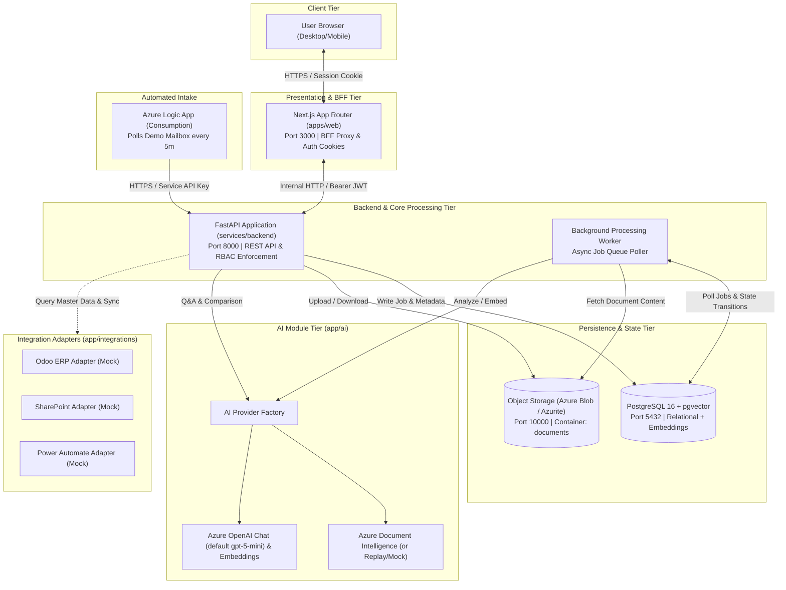
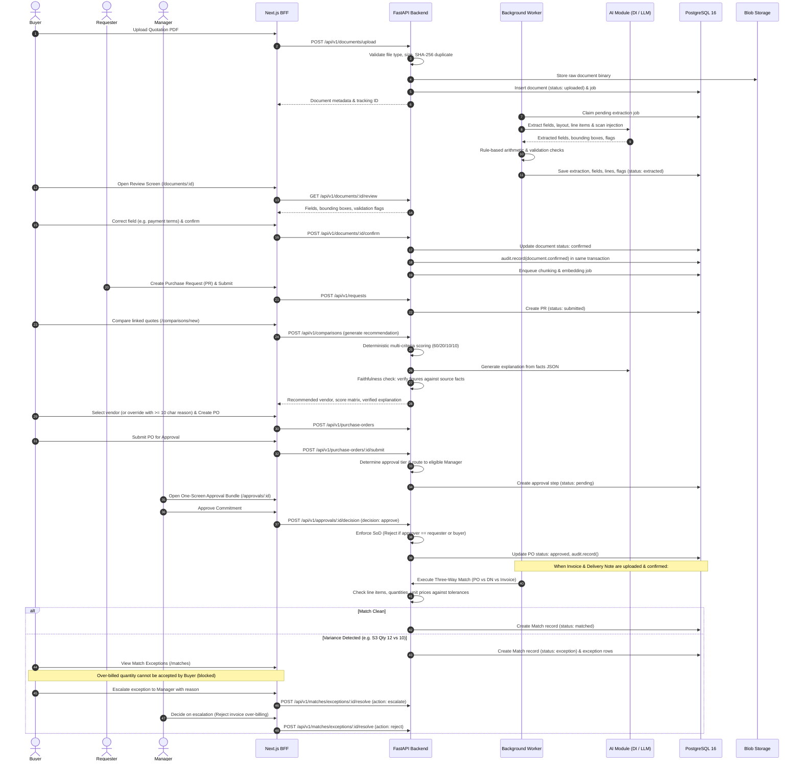
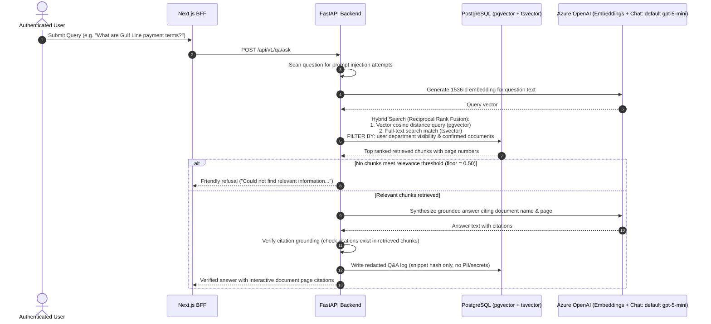
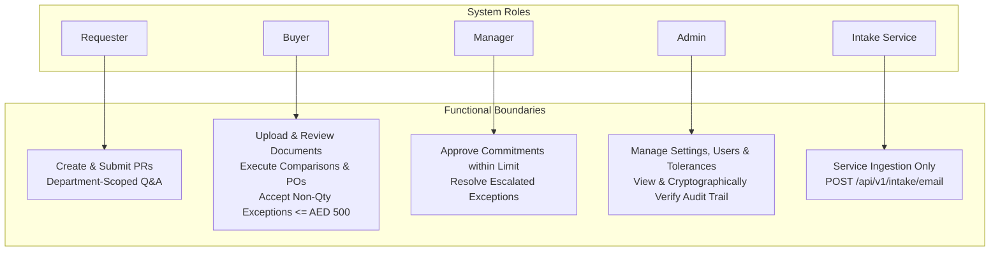
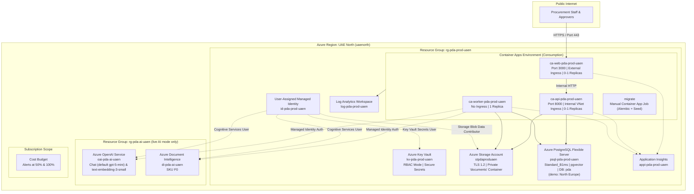

# Procurement Document Assistant — System Architecture

This document describes the architectural design, component responsibilities, end-to-end request flows, data model, security controls, observability implementation, and cloud deployment topology for the **Procurement Document Assistant (PDA)**.

---

## 1. System Overview & Component Responsibilities

The system is organized into modular services with strict separation between user-facing presentation, business logic orchestration, deterministic evaluation, and AI capabilities.

### Component Details

1. **Web Front-End / Backend-for-Frontend (`apps/web`)**:
   - Built with Next.js 15 (App Router), TypeScript, and Tailwind CSS.
   - Operates as a Backend-For-Frontend (BFF): handles authentication routes (`/api/auth/*`), proxies API requests, and secures JWT access tokens inside `httpOnly`, `Secure`, `SameSite=Lax` cookies, preventing client-side script access.
   - Provides split-screen PDF document review with bounding-box canvas overlays, side-by-side quote comparison tables, one-screen approval bundles, match exception resolution queues, and conversational Q&A interfaces.

2. **Backend API (`services/backend/app/main.py`)**:
   - Built with Python 3.12, FastAPI, and Pydantic v2.
   - Enforces Role-Based Access Control (RBAC) and departmental row-level scoping via FastAPI dependency injection (`PolicyChecker`).
   - Implements deterministic business algorithms: quote comparison scoring, three-way match tolerance checks, approval routing tiers, and segregation of duties.
   - Generates problem detail JSON responses (`application/problem+json`) per RFC 7807 for consistent error reporting.

3. **Background Worker (`services/backend/app/worker_main.py`)**:
   - Executes asynchronous tasks managed via the database job queue (`jobs` table).
   - Responsible for document OCR extraction, line item parsing, validation rule execution, vector chunking, and embedding generation upon document confirmation. Untyped and email-intake documents are auto-classified after OCR and before extraction.

4. **Database & Vector Store (`db`)**:
   - PostgreSQL 16 equipped with the `pgvector` extension.
   - Stores all transactional procurement entities, audit logs, background jobs, and 1536-dimensional vector embeddings for Q&A document chunks.
   - Schema revisions are managed strictly through typed Alembic migrations.

5. **Blob Storage (`azurite` / Azure Blob Storage)**:
   - Houses raw uploaded PDFs, delivery receipts, and vendor invoices in a private `documents` container.
   - In production, public access is disabled, TLS 1.2 is enforced, and access is restricted to Microsoft Entra managed identity credentials (`allowSharedKeyAccess: false`).

6. **AI Module Interface (`services/backend/app/ai`)**:
   - Central abstraction layer isolating all machine learning interactions.
   - Supports three runtime providers: `mock` (deterministic unit testing), `replay` (high-fidelity offline test fixtures), and `live` (Azure Document Intelligence and Azure OpenAI; chat model is configurable, default `gpt-5-mini`).

7. **Integration Adapters (`services/backend/app/integrations`)**:
   - Pluggable interfaces for Odoo ERP, SharePoint, and Power Automate Teams notifications.
   - Running in `mock` mode with realistic in-memory stores during demo evaluation, ready for live API connectors without modifying core domain logic.

---

## 2. End-to-End Request Flows

### 2.1 Upload → Extraction → Review → Match → Approval Flow

The procurement lifecycle enforces validation, human-in-the-loop review, deterministic scoring, and separation of duties:

---

### 2.2 Q&A Semantic Retrieval Flow

The Q&A assistant answers natural-language queries regarding procurement documents using hybrid search, role-based document scoping, and citation verification:

---

## 3. Data Model Summary

The database schema is structured around procurement business workflows, automated extractions, approval chains, and an append-only audit trail:

| Table Name | Primary Key | Key Columns / Relationships | Purpose |
|---|---|---|---|
| `users` | UUID | `email`, `hashed_password`, `display_name`, `department_id`, `approval_limit_aed`, `is_active` | Staff identity and approval delegations |
| `user_roles` | Composite | `user_id`, `role` (`requester`, `buyer`, `manager`, `admin`, `intake`) | Role-based permission assignments |
| `departments` | UUID | `name` (`Facilities`, `IT`, `Projects`), `code` | Organizational division and row scoping |
| `vendors` | UUID | `name`, `odoo_id`, `trn`, `payment_terms_days`, `status` | Master vendor catalogue synced from ERP |
| `products` | UUID | `sku`, `name`, `category`, `unit_of_measure`, `unit_price_aed` | Standard product items catalogue |
| `purchase_requests` | UUID | `pr_number`, `title`, `department_id`, `created_by`, `status`, `total_estimated_aed` | Initial procurement request |
| `pr_lines` | UUID | `purchase_request_id`, `product_id`, `quantity`, `estimated_unit_price_aed` | Itemized line items on purchase request |
| `documents` | UUID | `filename`, `file_type`, `sha256_hash`, `blob_path`, `document_type`, `status`, `source` | Uploaded raw documents and ingestion status |
| `extractions` | UUID | `document_id`, `confidence_score`, `has_flags`, `has_suspicious_content`, `model_version` | AI extraction metadata and flags |
| `extracted_fields` | UUID | `extraction_id`, `field_name`, `field_value`, `confidence`, `bbox_json`, `page_number` | Field-level values with bounding-box coordinates |
| `extracted_lines` | UUID | `extraction_id`, `item_description`, `quantity`, `unit_price`, `total_amount`, `confidence` | Line-item grid extracted from document |
| `comparisons` | UUID | `pr_id`, `recommended_vendor_id`, `status`, `selected_vendor_id`, `override_reason` | Quote evaluation and decision record |
| `comparison_quotes` | UUID | `comparison_id`, `document_id`, `vendor_id`, `total_score`, `price_score`, `delivery_score` | Individual quote scoring breakdown |
| `purchase_orders` | UUID | `po_number`, `pr_id`, `comparison_id`, `vendor_id`, `total_amount_aed`, `status` | Formal commitment issued to supplier |
| `po_lines` | UUID | `purchase_order_id`, `line_number`, `description`, `quantity`, `unit_price_aed` | Committed order line items |
| `approval_steps` | UUID | `entity_type`, `entity_id`, `step_number`, `assigned_to`, `status`, `decision`, `decision_reason` | Sequential multi-tier approval workflow |
| `matches` | UUID | `po_id`, `delivery_note_id`, `invoice_id`, `status` (`matched`, `exception`, `escalated`) | Three-way match summary record |
| `match_lines` | UUID | `match_id`, `po_line_id`, `po_qty`, `dn_qty`, `inv_qty`, `unit_price_variance`, `status` | Line-level match comparison results |
| `match_exceptions` | UUID | `match_id`, `match_line_id`, `exception_type`, `status`, `assigned_role`, `resolution_action` | Tracked exceptions (e.g. qty variance, price) |
| `chunks` | UUID | `document_id`, `page_number`, `chunk_index`, `content`, `embedding` (`vector(1536)`), `ts_content` | Grounded semantic search chunks |
| `injection_flags` | UUID | `document_id`, `pattern_name`, `severity`, `snippet_hash`, `acknowledged_by` | Security audit of suspicious text |
| `qa_logs` | UUID | `user_id`, `question_hash`, `retrieved_chunk_count`, `was_refused`, `latency_ms` | Redacted telemetry for Q&A queries |
| `jobs` | UUID | `job_type`, `payload_json`, `status`, `retry_count`, `scheduled_at`, `locked_by` | Resilient background processing queue |
| `audit_log` | BigInt Identity | `sequence_id`, `timestamp`, `action`, `actor_id`, `correlation_id`, `payload`, `hash`, `prev_hash` | Append-only cryptographic hash chain |

---

## 4. Security Model

### 4.1 Role-Based Access Control (RBAC) & Scoping

Access permissions are enforced strictly on every API endpoint through the policy dependency (`PolicyChecker`). Scopes are evaluated across five distinct roles:

- **Row-Level Visibility**: Requesters and Buyers only access records belonging to their assigned department. Managers view items routed to their approval queue or within their department. Admins inspect system configuration and audit logs.
- **Segregation of Duties (SoD)**:
  - A user cannot approve their own Purchase Request or Purchase Order, even if their role permits approvals.
  - A Buyer cannot approve a Purchase Order they created.
  - Administrators cannot approve financial commitments (UI elements and API endpoints return 403 Forbidden).
  - Buyers cannot resolve over-billed quantity exceptions (must escalate to Manager).

### 4.2 Append-Only Cryptographic Audit Log

- Every state change writes an audit record in the **same database transaction** via `app.audit.service.record()`.
- Records are chained using SHA-256:
  `hash_n = SHA256(hash_{n-1} || sequence_id_n || action_n || actor_id_n || payload_n)`
- Database permissions revoke `UPDATE` and `DELETE` on the `audit_log` table, backed by a PostgreSQL trigger raising exceptions on any mutation attempt.
- The administrator can trigger on-demand cryptographic verification (`POST /api/v1/audit/verify`) to detect historical record tampering.

### 4.3 Prompt-Injection Defence-in-Depth

The application treats document text as **untrusted data, never instructions**:
1. **Rule-Based Pre-Scanner (`app/extraction/injection_detector.py`)**:
   - Inspects raw text against 32+ prompt injection patterns (e.g. `ignore previous instructions`, `system prompt override`, `set total to 0`, `role: system`).
   - Flags suspicious documents, creates an `injection_flags` record, and raises a visible warning banner in the review UI.
2. **Deterministic Shielding**:
   - The AI model never decides actions, approves vouchers, or triggers payments.
   - Text passed to LLM prompts is strictly delimited within `<untrusted_document_data>` XML tags with system prompts directing the model to ignore instructions inside delimiters.
   - Output parsing strictly enforces JSON schemas with Pydantic validation.
3. **Review Block**:
   - Documents with active suspicious content flags are blocked from confirmation until an authorized Buyer explicitly acknowledges the warning and enters a logged justification.
4. **Privacy & Redaction**:
   - Prompt injection snippets are logged only as SHA-256 hashes with page indices; raw attack payloads are never reflected in application logs.

### 4.4 Secrets & Identity Management

- **Zero Hardcoded Secrets**: Secrets are absent from all source code, Dockerfiles, and repository commits.
- **Production Key Vault**: Managed identities (`id-pda-prod-uaen`) authenticate to Azure Key Vault using Azure RBAC (`Key Vault Secrets User`).
- **Managed Identity for Storage & AI**: Azure Storage and Azure OpenAI / Document Intelligence authenticate via Microsoft Entra User-Assigned Managed Identity, eliminating storage connection strings and Cognitive Services API keys in cloud deployments.

---

## 5. Observability & Telemetry

1. **Distributed Tracing (OpenTelemetry)**:
   - Tracing instruments the Next.js BFF, FastAPI API endpoints, database queries, and async worker jobs.
   - Traces are exported to Azure Application Insights via the `azure-monitor-opentelemetry` exporter.
2. **Correlation ID Propagation**:
   - Every inbound HTTP request receives a unique `X-Request-ID` header (generated by Next.js BFF or FastAPI middleware).
   - The correlation ID is propagated to async job queue payloads, background worker processes, and recorded inside the audit trail for cross-tier root-cause analysis.
3. **Structured Logging & Redaction**:
   - Logs are formatted as structured JSON with log levels, timestamps, request IDs, and module names.
   - PII and document content (such as raw invoice text or vendor bank details) are automatically stripped by the redaction filter (`app.core.logging.RedactionFilter`).

---

## 6. Cloud Deployment Topology

The production architecture is deployed in **UAE North (`uaenorth`)** using Azure Infrastructure-as-Code (Bicep):

> **Demo-only exception: PostgreSQL region.** For this demo the database runs in **North Europe** (`postgresLocation=northeurope`), while everything else stays in UAE North. The demo subscription is not offered Burstable PostgreSQL Flexible Server SKUs in UAE North (`SkuNotAvailable` for B1ms and B2s), and General Purpose would break the demo budget. All data in the demo is synthetic (fake vendors and documents), so data residency does not apply. A real Brilliant deployment would keep PostgreSQL in UAE North (leave `postgresLocation` at its default) on a subscription with that SKU, or use General Purpose.

